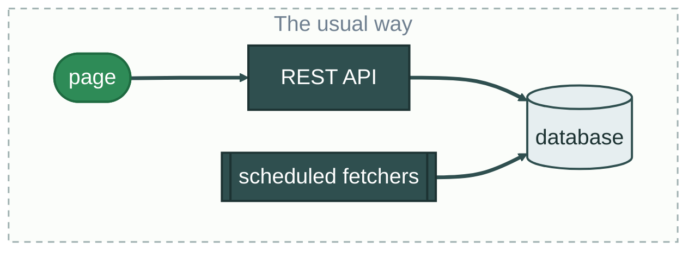
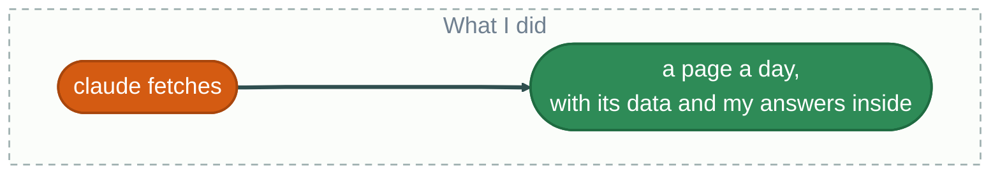
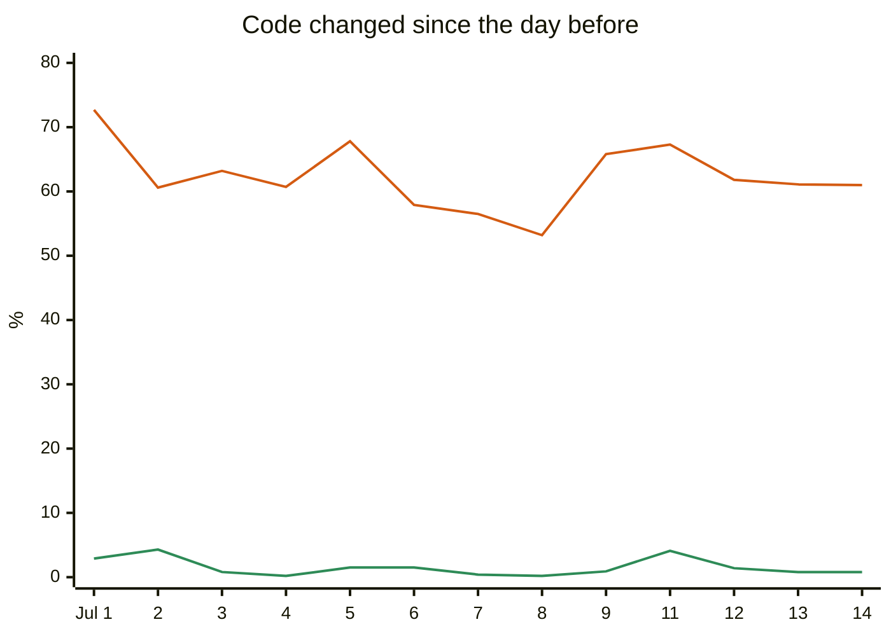
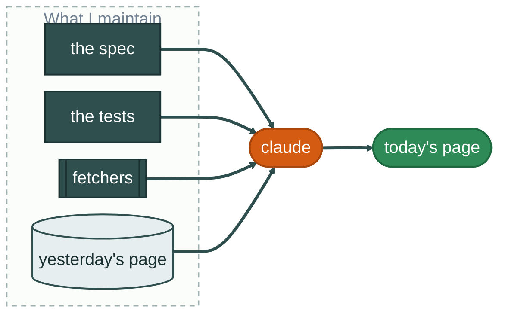

-----
title: Built For Today
time: 50m
background: images/background.png
font: avenir-next
title-font: iowan-old-style charter palatino georgia
tags: slides
-----

# Built For Today
## [A Java Developer's Experiment with Disposable Software]{darkslategray avenir-next}
### [[by]{slategray} Josh Cummings, [Spring Team Member]{seagreen}]{avenir-next}

linkedin:jzheaux[]

gh:jzheaux[]

bluesky:jzheaux[]

<!--
at: 0:00
time: 1m
ACT 0 · WHY A BURN JOURNAL (4 min).
The plan runs to 0:45, which leaves 5 minutes for the demos and stories to run long.
-->

---

## Burn Journals


<!--
time: 1.5m

A couple of years ago, I learned about something called a Burn Journal and I was immediately captivated. I've kept a journal all my life and I find that a lot of my thinking evens out once I have a chance to write it all down.

But, I'm also terrible about keeping track of all of it. And some of it I'm not really writing for anyone else to read ... or find. :)

The idea of a "burn journal" is something that you write, giving yourself permission to burn it, shred it, or destroy it in any way you like once the journal is completed.

-->

---

## A Security Engineer

* I'm [Josh Cummings](images/bio-me.jpg)
* I'm a [security engineer](https://github.com/jzheaux) with the [Spring Team]{seagreen}
* In April, I was part of [the following headline](https://www.nytimes.com/2026/04/22/technology/anthropics-mythos-ai.html):

```headline
Anthropic's New Mythos A.I. Model Sets Off Global Alarms
agency: The New York Times
by: Paul Mozur and Adam Satariano
```

<!--
time: 1.5m

Project Glasswing had announced partnerships with a number of commercially-backed open-source projects like Spring.

Our security advisories had gone up from 1-2 per month for Spring Security itself to more than 10 per day on average.

It was a busy time. I needed a burn journal.
-->

---

<!-- background: #D45B12 -->

# DEMO
::: avenir-next
## Where a Security Engineer Builds a [Burn Journal](http://localhost:3000/today)
:::

<!--
at: 0:04
time: 5m
DEMO 1 (5 min). Out by 0:09.

This is an app that I build every day afresh.
It has eleven slides and eleven tasks for me to complete.
They are each optional and there are several that I skip due to lack of time, but they are there for me if and when I'm ready.
Some of my favorites are the celebrations page, the gratitude page, and my reading log.

At the end of the day, the page becomes uneditable, and I can burn it or keep it. I usually keep them. :)

You can see that it pulls data from a number of heterogenous locations like Hardcover, Trello, and GitHub to provide a homogenous view that gets me ready for the day.

-->

---

## Early Objectives

* It should **feel like an app**, whether on my phone or my laptop
* It should be **secure** (go figure :shrug:)
* It should be **relevant to the day**
* It will **pull from several locations**

<!--
at: 0:09
time: 1m
ACT 1 · WHAT I BUILT (8 min).
-->

---

## What I Thought I'd Need



[Various flavors, going on about 40 years now]{slategray}

<!--
time: 1.5m
-->

---

## What I Built



[**80 lines** of prose]{chocolate} -> [**1,000 lines** of fully-contained HTML app]{seagreen}

<!--
time: 1.5m

Who has played with Dreambeans? Or if not, any kind of curated feed?
-->

---

## A Cached View

The app is a **cache** of the data.

::: columns
[**I got to skip**]{chocolate}
* A database, schema, and migrations
* Backend APIs and frontend/backend coordination
* Server-side sessions and CSRF protection
* Runtime credentials for external services
* Runtime API outages and quota handling
* An API gateway or aggregation layer
+++
[**By**]{seagreen}
* Generating a **self-contained**, interactive document
* Fetching external data **at build time**, as the spec defines
:::

<!--
time: 2m
-->

---

## A Record

The app is also a **record** of what I added.

1. Each is dated `YYYY-MM-DD.html`
2. Each is **uneditable** past that day

> [!IMPORTANT]
> That day's data and what I did with it are **saved together**, naturally

<!--
time: 1m
-->

---

## How Much Would You Pay?

```number
[$0.30/day]{seagreen}
to create the app
```

[*most of that is researching the daily celebrations*]{slategray}

<!--
time: 1m
-->

---

## Kirsch Offers a Warning

> Tests catch what you anticipated.
> Production catches what you didn't.
> -- Andreas Kirsch, [*The Flawed Ephemeral Software Hypothesis*](https://www.blackhc.net/essays/future_of_software/)

AI-regenerated code is the [**Rewrite Anti-pattern at machine speed**]{chocolate}. Rewrites forget:

1. **Edge cases** learned over time
2. **Integration quirks** with other systems
3. **Interface conventions**, and
4. **Ambiguity** in design specifications

<!--
at: 0:17
time: 2m
ACT 2 · KIRSCH'S WARNING, AND AN ACCIDENT (8 min).
-->

---

## Regeneration from Spec Alone

Kirsch was right. Every morning, [**a different app**]{chocolate}:

1. **Edge cases** -> auto-save on page-hide failed 70%+ of the time
2. **Integration quirks** -> `slide4_items` became `slide4_checked`
3. **Interface conventions** -> a button one day, a checkbox the next
4. **Ambiguity** -> "4-6 minutes": for me to sing, or for the AI to pick?

<!--
time: 3m

Same four things Kirsch said a rewrite forgets. One example each on the slide; here is the rest of what I saw.

Edge cases
- Auto-save on page-hide fails 70%+ of the time
- Injection allowed 80%+ of the time
- Failed to close off the day 100% of the time

Integration quirks
- Names of data keys changed: `slide4_items` became `slide4_checked`
- Slides would change from inferring "doneness" from context to using a completion marker

Interface conventions
- Sometimes "mark completed" was a checkbox instead of a button
- The ending emotion list was different each day, sometimes with as many as 48 emotions
- Singing notes missing pitch buttons 80%+ of the time

Ambiguity
- Singing Exercises' "4-6 minutes" was interpreted literally for the user vs. as a range for the AI to decide

But this isn't what I had been living with. Why not?

-->

---

## An Unexpected Benefit

```markdown {4-5}
Generate today’s YYYY-MM-DD.html in this directory. 
If it already exists, stop: it may already hold the day’s answers.

Start from the previous day’s HTML if there is one: 
copy it to today’s date, clear its answers, and replace its data with today’s.

There might be more requested slides today than yesterday. 
Ensure that new data keys do not collide with existing ones.
```

[*A throwaway thought, to put off building a template*]{slategray}

<!--
time: 2m
-->

---

## Copy-forward Stabilizes the App

::: columns
```number
[62%]{chocolate}
of the code changes each day with **rewrite**
```

```number
[0.03%]{seagreen}
of the code changes each day with **copy-forward**
```
:::

<!--
time: 1m

I gain UI stability and schema stability at the same time.
If I ever did want to look at data longitudinally, this will be critical.
-->

---

<!-- background: #D45B12 -->

# BUT
## [Bugs on Monday Copy to Tuesday]{avenir-next}

<!--
at: 0:25
time: 30s
ACT 3 · THE BUG THAT WOULDN'T LEAVE (13 min).
-->

---

<!-- background: #D45B12 -->

# DEMO
## [An [XSS Bug](http://localhost:3000/2026-10-02) That Wouldn't Leave]{avenir-next}

<!--
time: 5m
DEMO 2 (5 min). Out by 0:30:30.

sed -i '' -E 's/("slide3_video":)(null|"[^"]*")/\1"\\"><\/iframe>

---

## Two Truths and a Lie

1. Claude rejected my advice on how to fix it
2. The bug resurfaced each day
3. [Claude fixed it every day, four days in a row]{roboto} :angry:

<!--
time: 1.5m
-->

---

## Add a Review Step

:bulb: 
Change the spec to review yesterday's artifacts, find and fix bugs, add tests, and move the baseline forward.

::: columns
```number
[62%]{chocolate}
daily change with **rewrite**
```

```number
[1.5%]{seagreen}
daily change with **copy-forward + review**
```
:::




<!--
time: 2m
-->

---

## A Two-Week Automated Trial with Claude

**57 bugs**, in Kirsch's four kinds: 14 edge cases · 15 state and integration · 13 UI stability · 15 spec ambiguity

| A fresh agent given | Average Daily Change | Presence of Kirsch Bugs | Kirsch Bug Recurrence |
|---|---:|---|---|
| [rewrite]{chocolate} | 62% | 35%±3 | 32 |
| copy-forward | 0.03% | 35% | 0 |
| [**copy-forward + review**]{seagreen} | **1.5%** | 35% -> **19%** | 1 |

> [!NOTE]
> It could be interesting to try this with other models, other apps, other page types. Can a harness bring the bug rate down faster? Lots to explore!

<!--
time: 3m

I ran some automated trials of the app and classified the 57 most common bugs:

- 14 edge cases
- 15 state and integration bugs
- 13 UI stability bugs, and
- 15 bugs caused by ambiguity in the spec

One app, one model, two weeks, and the reviewer is the same model that built it. A story, not a study. If you want to take it further: a second model as reviewer, a second app, a longer run.

regen forgets lessons
copy-forward remembers mistakes
review moves things forward

-->

---

<!-- background: #D45B12 -->

**Code rewrites forget lessons**

**Copy-forward remembers mistakes**

**Review makes the fix stick**

<!--
time: 1m
-->

---

## What Actually Survives Tomorrow?

::: columns

```number
♻️
the spec, the tests, the fetchers, yesterday's example
```

```number
⏳
the generated app
```

:::

What survives still requires [**maintenance**]{seagreen} to preserve [**alignment**]{seagreen}

<!--
at: 0:38
time: 2.5m
CLOSE (7 min).

I thought I was breaking DRY by generating the same application every day. But I wasn't repeating the things that mattered. The specification, the tests, and the fetchers were shared. What I was duplicating was an artifact intentionally built for one day.
-->

---

## Maybe DRY Isn't About Code Copy-Pasta

> Every piece of knowledge must have a single, unambiguous, authoritative representation within a system.
> -- Andy Hunt and Dave Thomas, *The Pragmatic Programmer*



:thinking: Maybe it was always about avoiding duplicated **knowledge**. :thinking:

<!--
time: 2m

Remember "claude fetches" from the second diagram? This is what was inside it.
The fetchers and the store from the usual way didn't go away. They moved to build time, and the store became yesterday's page.
-->

---

# Built for Today
## [Throw Away the App]{avenir-next}
## [Keep What It Knows]{avenir-next seagreen}

<!--
time: 1.5m
-->

---

## Thank you!

gh:jzheaux/dev-to-next-2026[]
gh:spring-projects/spring-security[]

<!--
time: 1m
Done by 0:45. Q&A from here.
-->
